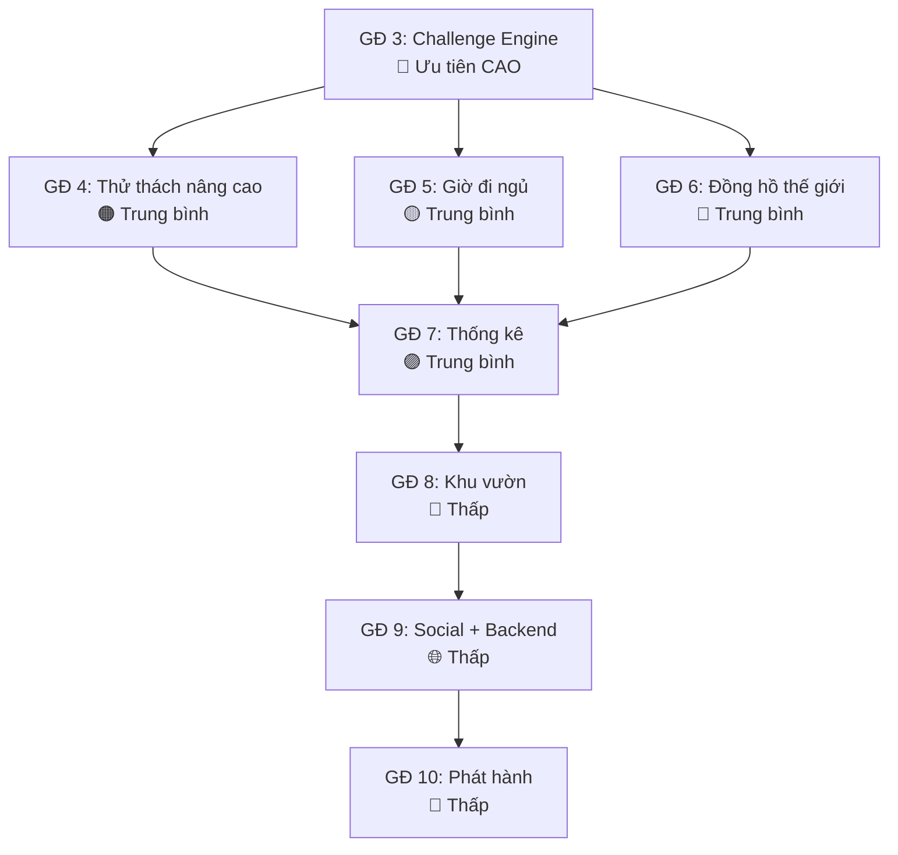

# 🗺️ Wake Up - Roadmap & Task List cho Gemini Code

> **Tài liệu này là lộ trình chi tiết cho các giai đoạn còn lại của dự án Wake Up.**
> Gemini Code chỉ cần đọc file này + `docs/PLAN.md` trước mỗi giai đoạn.

---

## 📊 Tình trạng hiện tại (v0.4.1)

| Giai đoạn | Trạng thái | Ghi chú |
|-----------|-----------|---------|
| GĐ 0 - Khởi tạo, theme, DB, điều hướng | ✅ Hoàn thành | 5 tab, Cupertino dark theme, Drift DB v3 |
| GĐ 1 - Báo thức cốt lõi Android | ✅ Hoàn thành | `AlarmScheduler` interface, exact alarm, foreground service |
| GĐ 2 - Âm thanh + video tùy chỉnh | ✅ Hoàn thành | Video nền, chọn âm thanh, "none" option, Samsung time picker |
| GĐ 3 - Chế độ sâu + challenge engine | ❌ Chưa bắt đầu | Thư mục `challenges/` trống |
| GĐ 4 - Thử thách nâng cao | ❌ Chưa bắt đầu | |
| GĐ 5 - Giờ đi ngủ | ❌ Chưa bắt đầu | Chỉ có placeholder screen |
| GĐ 6 - Đồng hồ thế giới | ❌ Chưa bắt đầu | Chỉ có placeholder screen |
| GĐ 7 - Theo dõi hành vi + thống kê | ❌ Chưa bắt đầu | Chỉ có placeholder screen |
| GĐ 8 - Khu vườn + gamification | ❌ Chưa bắt đầu | Chỉ có placeholder screen |
| GĐ 9 - Bạn bè + bảng xếp hạng | ❌ Chưa bắt đầu | Cần backend |
| GĐ 10 - Kiểm thử + phát hành | ❌ Chưa bắt đầu | |

### Codebase hiện có cần nắm:
- **Database**: Drift SQLite v3, bảng `Alarms` tại [alarm_table.dart](file:///D:/Alarm%20project/wake_up/lib/core/database/tables/alarm_table.dart) (đã có cột `challenges`, `timezone` nullable sẵn)
- **State**: Riverpod
- **Navigation**: go_router
- **Alarm Scheduler**: Interface tại `domain/`, implementations Android/iOS tại `data/`
- **Thư mục feature**: `alarms/` (đủ data/domain/presentation), các tab còn lại chỉ có `presentation/` với placeholder screen

---

## 🔴 Giai đoạn 3: Chế độ Sâu + Challenge Engine (Ưu tiên CAO)

> **Mục tiêu**: Khi báo thức reo ở chế độ "deep", người dùng phải hoàn thành thử thách mới tắt được. Luôn có lối thoát khẩn cấp.

### 3.1 Challenge Engine Core

#### Task 3.1.1 - Tạo Challenge interface
- **File**: `lib/features/challenges/domain/challenge.dart`
- **Nội dung**:
```dart
abstract class Challenge {
  String get type; // 'math', 'shake', 'qr'
  Map<String, dynamic> get config;
  Future<void> start();
  Future<bool> verify(dynamic answer);
  void reset();
  void dispose();
}
```
- **Test**: Unit test cho interface contract

#### Task 3.1.2 - Tạo ChallengeFactory
- **File**: `lib/features/challenges/domain/challenge_factory.dart`
- **Nội dung**: Factory pattern tạo Challenge từ type string + config JSON
- **Test**: Factory tạo đúng loại challenge

#### Task 3.1.3 - Tạo ChallengeConfig model
- **File**: `lib/features/challenges/domain/challenge_config.dart`
- **Nội dung**: Model cho cấu hình thử thách (type, difficulty, params)
- Serialize/deserialize JSON để lưu vào cột `challenges` trong bảng `Alarms`
- **Test**: JSON round-trip serialization

### 3.2 Math Challenge (Thử thách đầu tiên)

#### Task 3.2.1 - Logic sinh câu toán
- **File**: `lib/features/challenges/domain/math_challenge.dart`
- **Nội dung**:
  - 3 mức khó: Dễ (cộng/trừ 1-2 chữ số), Trung bình (nhân/chia 1-2 chữ số), Khó (phép tính hỗn hợp 2-3 chữ số)
  - Sinh 3 câu ngẫu nhiên, trả lời sai thì sinh câu mới
  - Dart thuần, không phụ thuộc UI
- **Test**: ≥5 unit test (sinh câu đúng range, verify đáp án đúng/sai, reset tạo câu mới, difficulty levels)

#### Task 3.2.2 - UI màn hình thử thách toán
- **File**: `lib/features/challenges/presentation/math_challenge_screen.dart`
- **Nội dung**:
  - Hiển thị câu toán lớn, bàn phím số, nút xác nhận
  - Progress indicator (1/3, 2/3, 3/3)
  - Animation khi đúng (✅ xanh) / sai (❌ đỏ, rung nhẹ)
  - Cupertino style, dark theme, cam accent
- **Lưu ý**: Chuông vẫn reo trong lúc làm thử thách

### 3.3 Shake Challenge (Lắc điện thoại)

#### Task 3.3.1 - Logic lắc
- **File**: `lib/features/challenges/domain/shake_challenge.dart`
- **Package cần thêm**: `sensors_plus` (đã có trong PLAN.md)
- **Nội dung**:
  - Gia tốc kế, ngưỡng tùy chỉnh (mặc định 15G), debounce 500ms
  - Số lần lắc tùy chỉnh (mặc định 30 lần)
  - Cung cấp stream `shakeCount` để UI listen
- **Test**: Unit test cho logic đếm (mock accelerometer events)

#### Task 3.3.2 - UI màn hình lắc
- **File**: `lib/features/challenges/presentation/shake_challenge_screen.dart`
- **Nội dung**:
  - Circular progress hiển thị số lần lắc / tổng
  - Animation rung/bounce khi nhận lắc
  - Icon điện thoại lắc

### 3.4 QR Code Challenge

#### Task 3.4.1 - Logic QR
- **File**: `lib/features/challenges/domain/qr_challenge.dart`
- **Package cần thêm**: `mobile_scanner` (đã có trong PLAN.md)
- **Nội dung**:
  - Lúc cài đặt: quét và lưu hash SHA-256 của mã QR/barcode
  - Lúc reo: so khớp hash
  - Hỗ trợ nhiều mã cho một báo thức
- **Test**: Unit test cho hash comparison

#### Task 3.4.2 - UI quét QR khi cài đặt
- **File**: `lib/features/challenges/presentation/qr_setup_screen.dart`
- **Nội dung**: Camera preview + overlay QR frame, danh sách mã đã quét, nút xóa

#### Task 3.4.3 - UI quét QR khi reo
- **File**: `lib/features/challenges/presentation/qr_challenge_screen.dart`
- **Nội dung**: Camera preview full-screen, hướng dẫn "Quét mã đã đăng ký", feedback khi khớp/không khớp

### 3.5 Tích hợp vào Alarm Flow

#### Task 3.5.1 - Cập nhật Alarm Edit Screen
- **File**: Sửa [alarm_edit_screen.dart](file:///D:/Alarm%20project/wake_up/lib/features/alarms/presentation/alarm_edit_screen.dart)
- **Nội dung**:
  - Thêm section "Chế độ đánh thức" với toggle Normal/Deep
  - Khi chọn Deep → hiển thị danh sách thử thách có thể chọn (multi-select)
  - Mỗi thử thách có nút config (mức khó toán, số lần lắc, quét QR setup)
  - Lưu cấu hình vào cột `challenges` (JSON) và `mode` = 'deep'

#### Task 3.5.2 - Cập nhật Alarm Ringing Screen
- **File**: Sửa [alarm_ringing_screen.dart](file:///D:/Alarm%20project/wake_up/lib/features/alarms/presentation/alarm_ringing_screen.dart)
- **Nội dung**:
  - Nếu `mode == 'deep'`: thay nút "Tắt" bằng "Bắt đầu thử thách"
  - Navigate qua từng challenge screen theo thứ tự
  - Hoàn thành tất cả → dismiss alarm
  - **Lối thoát khẩn cấp**: Giữ nút 10 giây HOẶC tự mở khóa sau 15 phút

#### Task 3.5.3 - Chuỗi báo thức dự phòng
- **Nội dung**: Khi chuông reo ở chế độ sâu, tự đặt thêm báo thức lặp mỗi 2 phút. Chỉ hủy khi hoàn thành thử thách.
- **Lưu ý**: Cần test trên thiết bị thật

### 3.6 Tiêu chí hoàn thành GĐ 3
- [ ] `flutter analyze` sạch
- [ ] ≥15 unit tests cho logic challenges (math, shake counting, QR hash)
- [ ] Chế độ sâu hoạt động end-to-end trên Android
- [ ] Lối thoát khẩn cấp hoạt động
- [ ] Không thể test trên emulator: lắc điện thoại, quét QR thật → liệt kê bước test tay

---

## 🟠 Giai đoạn 4: Thử thách nâng cao (Ưu tiên TRUNG BÌNH)

> **Mục tiêu**: Thêm 3 loại thử thách còn lại: sắp xếp chữ cái, chụp vật đã đăng ký, selfie.

### 4.1 Word Sorting Challenge (Sắp xếp chữ cái)

#### Task 4.1.1 - Tạo kho từ vựng
- **File**: `lib/features/challenges/data/word_bank.dart`
- **Nội dung**:
  - Kho từ Việt (≥100 từ) và Anh (≥100 từ), phân theo độ khó
  - Xử lý dấu tiếng Việt (so sánh Unicode)
  - Chọn ngẫu nhiên từ theo mức khó

#### Task 4.1.2 - Logic sắp xếp
- **File**: `lib/features/challenges/domain/word_sort_challenge.dart`
- **Nội dung**: Xáo trộn ký tự, verify thứ tự đúng, hỗ trợ dấu tiếng Việt
- **Test**: Unit test cho compare Unicode, verify sorted

#### Task 4.1.3 - UI kéo thả chữ cái
- **File**: `lib/features/challenges/presentation/word_sort_challenge_screen.dart`
- **Nội dung**: Drag-and-drop ô chữ cái, animation swap, hiệu ứng hoàn thành

### 4.2 Object Photo Challenge (Chụp vật đã đăng ký)

#### Task 4.2.1 - Setup embedding comparison
- **Package cần thêm**: `google_mlkit_image_labeling` (đã có trong PLAN.md)
- **File**: `lib/features/challenges/domain/object_photo_challenge.dart`
- **Nội dung**:
  - Lúc cài đặt: chụp ảnh tham chiếu, trích xuất label embeddings
  - Lúc reo: chụp ảnh mới, so cosine similarity
  - Ngưỡng similarity chỉnh được (mặc định 0.7)
  - Có bước "thử trước" khi cài đặt để kiểm tra ngưỡng

#### Task 4.2.2 - UI setup ảnh tham chiếu
- **File**: `lib/features/challenges/presentation/object_photo_setup_screen.dart`

#### Task 4.2.3 - UI chụp ảnh khi reo
- **File**: `lib/features/challenges/presentation/object_photo_challenge_screen.dart`

### 4.3 Selfie Challenge (Selfie trước gương)

#### Task 4.3.1 - Face detection logic
- **Package cần thêm**: `camera`, `google_mlkit_face_detection` (đã có trong PLAN.md)
- **File**: `lib/features/challenges/domain/selfie_challenge.dart`
- **Nội dung**: Camera trước + ML Kit phát hiện khuôn mặt (chỉ cần detect face, không verify gương)
- **Test**: Mock face detection result

#### Task 4.3.2 - UI selfie challenge
- **File**: `lib/features/challenges/presentation/selfie_challenge_screen.dart`
- **Nội dung**: Camera trước preview, overlay hướng dẫn, countdown khi phát hiện mặt

### 4.4 Tiêu chí hoàn thành GĐ 4
- [ ] Tất cả 6 loại thử thách hoạt động ổn định
- [ ] Unit test cho logic word sort (≥5 tests), object comparison
- [ ] Không thể test trên emulator: camera, ML Kit → liệt kê bước test tay
- [ ] `flutter analyze` sạch

---

## 🟡 Giai đoạn 5: Giờ đi ngủ (Ưu tiên TRUNG BÌNH)

> **Mục tiêu**: Tab "Giờ ngủ" tính toán và nhắc giờ đi ngủ dựa trên chu kỳ ngủ.

### 5.1 Domain Logic (Dart thuần)

#### Task 5.1.1 - Tính giờ ngủ
- **File**: `lib/features/bedtime/domain/sleep_calculator.dart`
- **Công thức**: `giờ_ngủ = giờ_dậy − (số_chu_kỳ × 90 phút) − thời_gian_chuẩn_bị`
- **Nội dung**:
  - Mặc định: 5-6 chu kỳ, thời gian chuẩn bị 15 phút
  - Gợi ý nhiều mốc giờ ngủ (4, 5, 6 chu kỳ)
  - Cảnh báo khi < 6 giờ (ngưỡng chỉnh được)
- **Test**: ≥8 unit tests (các trường hợp biên: qua nửa đêm, thời gian chuẩn bị khác nhau, cảnh báo ngắn)

#### Task 5.1.2 - SleepSchedule model
- **File**: `lib/features/bedtime/domain/sleep_schedule.dart`
- **Nội dung**: Model cho `SleepSchedule` (weekday, wakeTime, targetHours, prepMinutes)

### 5.2 Data Layer

#### Task 5.2.1 - Bảng SleepSchedule trong DB
- **File**: Tạo `lib/core/database/tables/sleep_schedule_table.dart`
- Cập nhật [app_database.dart](file:///D:/Alarm%20project/wake_up/lib/core/database/app_database.dart): thêm bảng, tăng schema version
- **File**: `lib/features/bedtime/data/sleep_schedule_repository.dart`
- Chạy `build_runner` để generate lại

#### Task 5.2.2 - Notification nhắc đi ngủ
- Dùng `flutter_local_notifications` (đã có trong pubspec)
- Đặt lịch notification trước giờ ngủ gợi ý 30 phút (chỉnh được)

### 5.3 Presentation

#### Task 5.3.1 - Bedtime Screen chính
- **File**: Thay [bedtime_screen.dart](file:///D:/Alarm%20project/wake_up/lib/features/bedtime/presentation/bedtime_screen.dart)
- **Nội dung**:
  - Vòng tròn kiểu iOS Clock (drag giờ ngủ ↔ giờ dậy)
  - Hiển thị thời lượng ngủ dự kiến
  - Danh sách mốc giờ ngủ gợi ý theo chu kỳ 90 phút
  - Lịch ngủ theo từng ngày trong tuần
  - Cảnh báo vàng/đỏ nếu ngủ quá ngắn

#### Task 5.3.2 - Bedtime Settings
- **Nội dung**: Screen cài đặt: thời gian chuẩn bị, ngưỡng cảnh báo, bật/tắt nhắc ngủ

### 5.4 Tiêu chí hoàn thành GĐ 5
- [ ] Tính giờ ngủ chính xác, unit test pass
- [ ] Nhắc ngủ bằng notification hoạt động
- [ ] Cảnh báo ngủ ngắn hiển thị đúng
- [ ] `flutter analyze` sạch

---

## 🔵 Giai đoạn 6: Đồng hồ thế giới + Múi giờ (Ưu tiên TRUNG BÌNH)

> **Mục tiêu**: Tab "Thế giới" hiển thị giờ nhiều thành phố, hỗ trợ báo thức theo múi giờ.

### 6.1 Domain Logic

#### Task 6.1.1 - WorldClock model & timezone handling
- **Package cần thêm**: `timezone`, `flutter_timezone` (đã có trong PLAN.md)
- **File**: `lib/features/world_clock/domain/world_clock.dart`
- **Nội dung**:
  - Model: `WorldClock(id, cityName, ianaTimezone, displayName)`
  - Tính giờ hiện tại theo timezone
  - Tính chênh lệch so với giờ máy
  - Xử lý DST (giờ mùa hè)
- **Test**: ≥6 unit tests (chuyển đổi timezone, DST transition, chênh lệch)

#### Task 6.1.2 - Tính lại báo thức theo múi giờ
- **File**: `lib/features/world_clock/domain/timezone_alarm_calculator.dart`
- **Nội dung**: Quy giờ địa phương + IANA timezone → thời điểm tuyệt đối UTC
- **Lưu ý**: Phải tính lại mỗi khi mở app hoặc timezone đổi
- **Test**: ≥4 unit tests (DST forward, DST backward, timezone change)

### 6.2 Data Layer

#### Task 6.2.1 - Bảng WorldClock trong DB
- **File**: `lib/core/database/tables/world_clock_table.dart`
- Cập nhật `app_database.dart`, tăng schema version
- **File**: `lib/features/world_clock/data/world_clock_repository.dart`

#### Task 6.2.2 - Danh sách thành phố tĩnh
- **File**: `lib/features/world_clock/data/city_database.dart`
- **Nội dung**: Danh sách ≥200 thành phố phổ biến kèm IANA timezone, hỗ trợ tìm kiếm

### 6.3 Presentation

#### Task 6.3.1 - World Clock Screen chính
- **File**: Thay [world_clock_screen.dart](file:///D:/Alarm%20project/wake_up/lib/features/world_clock/presentation/world_clock_screen.dart)
- **Nội dung**:
  - Danh sách thành phố đã thêm, hiển thị giờ hiện tại + chênh lệch
  - Real-time update (timer tick mỗi giây)
  - Nút "+" thêm thành phố, tìm kiếm
  - Vuốt để xóa
  - Analog/digital clock nhỏ cho mỗi thành phố

#### Task 6.3.2 - Chế độ lịch họp quốc tế
- **Nội dung**: Chọn giờ → hiển thị giờ tương ứng ở tất cả thành phố đã thêm
- **Giao diện**: Timeline dạng ngang, highlight giờ làm việc (9h-17h)

### 6.4 Tiêu chí hoàn thành GĐ 6
- [ ] Giờ thế giới cập nhật real-time
- [ ] Báo thức theo múi giờ kêu đúng giờ
- [ ] DST xử lý chính xác (test bằng timezone giả lập)
- [ ] `flutter analyze` sạch

---

## 🟣 Giai đoạn 7: Theo dõi hành vi + Thống kê (Ưu tiên TRUNG BÌNH)

> **Mục tiêu**: Tab "Thống kê" hiển thị dữ liệu hành vi **ước tính** từ báo thức.

### 7.1 Domain Logic

#### Task 7.1.1 - AlarmEvent model
- **File**: `lib/features/analytics/domain/alarm_event.dart`
- **Nội dung**: Event types: `ring_fired`, `ring_opened`, `snooze`, `challenge_started`, `challenge_completed`, `dismissed`
- Kèm timestamp, alarmId

#### Task 7.1.2 - Tính metrics
- **File**: `lib/features/analytics/domain/analytics_calculator.dart`
- **Nội dung** (Dart thuần):
  - Độ trễ trung bình: thời gian từ `ring_fired` đến `dismissed`
  - Số lần báo lại trung bình
  - Ngày trong tuần hay dậy muộn nhất
  - Chuỗi ngày dậy đúng giờ
  - Tỉ lệ hoàn thành thử thách
- **Test**: ≥8 unit tests với dữ liệu giả lập

### 7.2 Data Layer

#### Task 7.2.1 - Bảng AlarmEvent trong DB
- **File**: `lib/core/database/tables/alarm_event_table.dart`
- Cập nhật `app_database.dart`
- **File**: `lib/features/analytics/data/alarm_event_repository.dart`

#### Task 7.2.2 - Ghi sự kiện tự động
- Tích hợp vào alarm ringing flow: ghi event khi chuông reo, khi snooze, khi dismiss, khi bắt đầu/hoàn thành challenge

### 7.3 Presentation

#### Task 7.3.1 - Analytics Screen chính
- **Package cần thêm**: `fl_chart` (đã có trong PLAN.md)
- **File**: Thay [analytics_screen.dart](file:///D:/Alarm%20project/wake_up/lib/features/analytics/presentation/analytics_screen.dart)
- **Nội dung**:
  - **Tuần này**: Bar chart thời gian dậy mỗi ngày
  - **Tháng này**: Line chart xu hướng thời gian dậy
  - **Thống kê nhanh**: Cards hiển thị avg delay, streak, tỉ lệ challenge
  - **Ngày hay dậy muộn**: Pie chart theo thứ
  - Filter: tuần / tháng / 3 tháng / năm

> [!IMPORTANT]
> **Bắt buộc**: Mọi nơi hiển thị dùng "dữ liệu hành vi **ước tính**", "**dựa trên** hành vi báo thức". Không khẳng định người dùng "đã ngủ" hay "đã thức dậy" như sự thật.

### 7.4 Tiêu chí hoàn thành GĐ 7
- [ ] Biểu đồ hiển thị đúng với dữ liệu giả lập
- [ ] Sự kiện được ghi tự động khi dùng báo thức
- [ ] Ngôn ngữ "ước tính" nhất quán
- [ ] `flutter analyze` sạch, unit test pass

---

## 🌿 Giai đoạn 8: Khu vườn ảo + Gamification (Ưu tiên THẤP)

> **Mục tiêu**: Tab "Khu vườn" - hệ thống điểm, chuỗi ngày, cây phát triển.

### 8.1 Domain Logic

#### Task 8.1.1 - Scoring system
- **File**: `lib/features/garden/domain/score_calculator.dart`
- **Công thức điểm**:
  - Điểm cơ bản: 100 (dậy đúng giờ)
  - Thưởng chế độ sâu: +50
  - Thưởng chuỗi ngày: +10 × số ngày liên tiếp (cap 500)
  - Trừ báo lại: -20 × số lần snooze
  - Trừ trễ: -5 × số phút trễ (cap -100)
- **Test**: ≥10 unit tests (tất cả trường hợp tính điểm)

#### Task 8.1.2 - GardenState model
- **File**: `lib/features/garden/domain/garden_state.dart`
- **Nội dung**: points, streak, currentPlant, growthStage, unlockedItems, lastWakeDate
- Plant stages: seed → sprout → sapling → young_tree → mature_tree (5 giai đoạn)
- Bỏ lỡ 1 ngày → ngừng phát triển (không chết)

#### Task 8.1.3 - Item & Achievement system
- **File**: `lib/features/garden/domain/garden_items.dart`
- **Nội dung**:
  - Cây: ≥8 loại (cherry blossom, oak, bamboo, sunflower, cactus, bonsai, palm, maple)
  - Vật phẩm: "Đóng băng chuỗi" (dùng khi bỏ lỡ 1 ngày), "Phân bón" (x2 điểm 1 ngày)
  - Thành tích: "7 ngày liên tiếp", "30 ngày", "100 ngày", "Hoàn thành 50 thử thách", etc.
  - Mở khóa bằng điểm tích lũy

### 8.2 Data Layer

#### Task 8.2.1 - Bảng GardenState, Plants, Achievements trong DB
- Cập nhật `app_database.dart`, tăng schema version
- **File**: `lib/features/garden/data/garden_repository.dart`

### 8.3 Presentation

#### Task 8.3.1 - Garden Screen chính
- **File**: Thay [garden_screen.dart](file:///D:/Alarm%20project/wake_up/lib/features/garden/presentation/garden_screen.dart)
- **Nội dung**:
  - Vườn cây hiển thị cây đang trồng (animation phát triển)
  - Điểm và chuỗi ngày ở góc trên
  - Grid danh sách cây đã mở khóa / chưa mở khóa (silhouette)
  - Tab "Thành tích" với badges
  - Tab "Cửa hàng" mua vật phẩm bằng điểm

#### Task 8.3.2 - Plant animations
- **Nội dung**: Animation đơn giản cho từng giai đoạn cây (scale + fade transition khi lên cấp)
- Có thể dùng CustomPainter hoặc Lottie/SVG assets

> [!TIP]
> **Gợi ý tham khảo**: App "Forest" (Focus Timer), "Plannie" - cơ chế gamification tương tự. Giữ đơn giản và pixel-art style cho MVP.

### 8.4 Tiêu chí hoàn thành GĐ 8
- [ ] Tính điểm chính xác theo unit test
- [ ] Cây phát triển khi dậy đúng giờ
- [ ] Chuỗi ngày + đóng băng chuỗi hoạt động
- [ ] Thành tích mở khóa đúng điều kiện
- [ ] `flutter analyze` sạch

---

## 🌐 Giai đoạn 9: Bạn bè + Bảng xếp hạng (Ưu tiên THẤP - Cần Backend)

> **Mục tiêu**: Social features - kết bạn, so sánh chuỗi ngày, bảng xếp hạng.

### 9.1 Backend Setup

#### Task 9.1.1 - Chọn và setup Firebase/Supabase
- **Quyết định cần hỏi user**: Firebase hay Supabase?
- **Nội dung**:
  - Authentication (email/Google sign-in)
  - Firestore/Database cho user profiles, friend lists, leaderboard
  - Cloud Functions cho anti-cheat validation

#### Task 9.1.2 - User model & Auth flow
- **File**: `lib/features/auth/` (tạo mới feature)
- **Nội dung**: Sign in, profile, avatar

### 9.2 Social Features

#### Task 9.2.1 - Friend system
- **Nội dung**: Thêm bạn bằng mã/QR, danh sách bạn bè, xem profile bạn

#### Task 9.2.2 - Leaderboard
- **Nội dung**:
  - Bảng xếp hạng bạn bè theo: chuỗi ngày, tổng điểm, tỉ lệ dậy đúng giờ
  - Tuần / tháng / tất cả
  - Chống gian lận: tính điểm từ log sự kiện, rate limit

### 9.3 Tiêu chí hoàn thành GĐ 9
- [ ] Đăng nhập hoạt động
- [ ] Kết bạn và xem bảng xếp hạng
- [ ] Dữ liệu hành vi chỉ upload điểm và chuỗi (không upload ảnh, embedding)
- [ ] `flutter analyze` sạch

---

## 🏁 Giai đoạn 10: Kiểm thử nhiều máy + Tối ưu + Phát hành (Ưu tiên THẤP)

### 10.1 Compatibility Testing

#### Task 10.1.1 - OEM-specific alarm handling
- **Nội dung**:
  - Tạo màn hướng dẫn cấp quyền cho Xiaomi, Oppo, Samsung, Huawei, Vivo
  - Hướng dẫn bật "Tự khởi động", "Không giới hạn pin", "Cho phép hoạt động nền"
  - Detect OEM và hiển thị hướng dẫn phù hợp

#### Task 10.1.2 - Permission checklist
- **Nội dung**: Kiểm tra và yêu cầu tất cả quyền cần thiết:
  - Exact alarm (Android 12+)
  - Full-screen intent (Android 14+)
  - Notification
  - Camera (cho challenges)
  - Microphone (nếu cần)
  - Storage (cho media)

### 10.2 Performance Optimization

#### Task 10.2.1 - Tối ưu pin
- Giảm thiểu wake lock
- Tối ưu video playback khi ringing
- Lazy load UI components

#### Task 10.2.2 - App size optimization
- Tree-shake unused code
- Compress assets
- ProGuard optimization (đã có base setup)

### 10.3 Store Preparation

#### Task 10.3.1 - Play Store listing
- Screenshots, mô tả, icon, feature graphic
- Privacy policy (ảnh, camera chỉ xử lý trên máy)

#### Task 10.3.2 - App Store listing (nếu có Mac)
- Tương tự Play Store
- TestFlight beta testing

---

## 📦 Packages cần thêm theo giai đoạn

| GĐ | Package | Mục đích | Kiểm tra pub.dev trước |
|----|---------|----------|----------------------|
| 3 | `sensors_plus` | Gia tốc kế cho shake challenge | ✅ |
| 3 | `mobile_scanner` | Quét QR/barcode | ✅ |
| 4 | `camera` | Camera cho selfie/object photo | ✅ |
| 4 | `google_mlkit_face_detection` | Phát hiện khuôn mặt | ✅ |
| 4 | `google_mlkit_image_labeling` | Nhận diện vật thể | ✅ |
| 6 | `timezone` | Xử lý múi giờ | ✅ |
| 6 | `flutter_timezone` | Lấy timezone thiết bị | ✅ |
| 7 | `fl_chart` | Biểu đồ thống kê | ✅ |
| 9 | `firebase_core`, `firebase_auth`, `cloud_firestore` HOẶC `supabase_flutter` | Backend | ✅ |

> [!WARNING]
> **Không thêm package ngoài danh sách trên mà chưa hỏi user.** Luôn kiểm tra pub.dev trước khi thêm.

---

## 🔄 Thứ tự ưu tiên khuyến nghị



**Gợi ý**: GĐ 5, 6 có thể làm song song hoặc trước GĐ 4 nếu muốn đa dạng tính năng sớm.

---

## 📋 Quy trình cho mỗi Giai đoạn (Gemini Code phải tuân thủ)

1. **Đọc** `docs/PLAN.md` + roadmap này
2. **Đưa ra kế hoạch triển khai chi tiết** → **DỪNG LẠI CHỜ USER DUYỆT**
3. Chỉ làm đúng phạm vi giai đoạn
4. Logic nghiệp vụ = Dart thuần + unit test
5. Mọi truy cập nền tảng qua interface trừu tượng
6. Kết thúc: `flutter analyze` sạch, unit test pass, danh sách test tay
7. Nói rõ những gì **không thể** tự xác minh

---

> **Cập nhật lần cuối**: v0.4.1 (21/10/2026)
